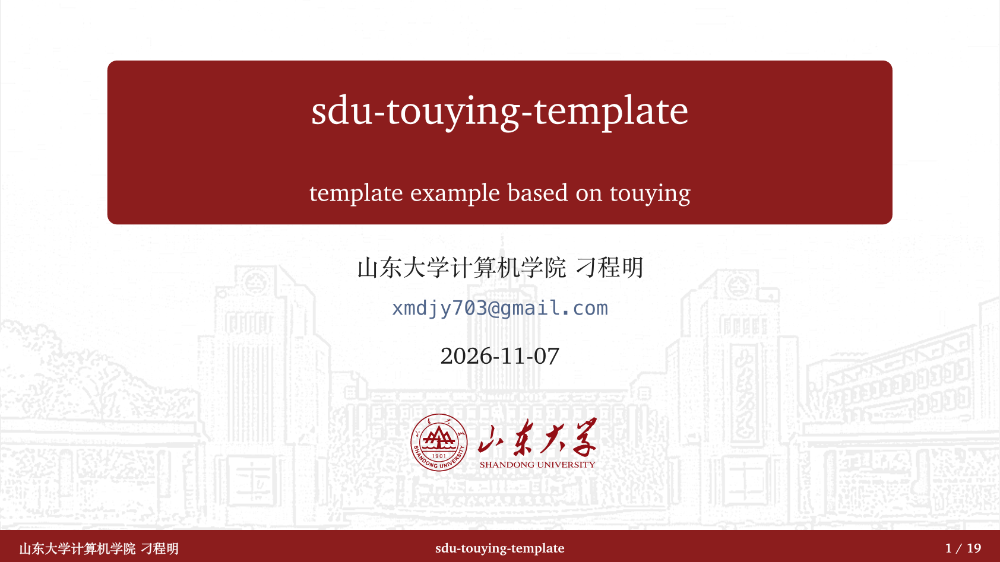
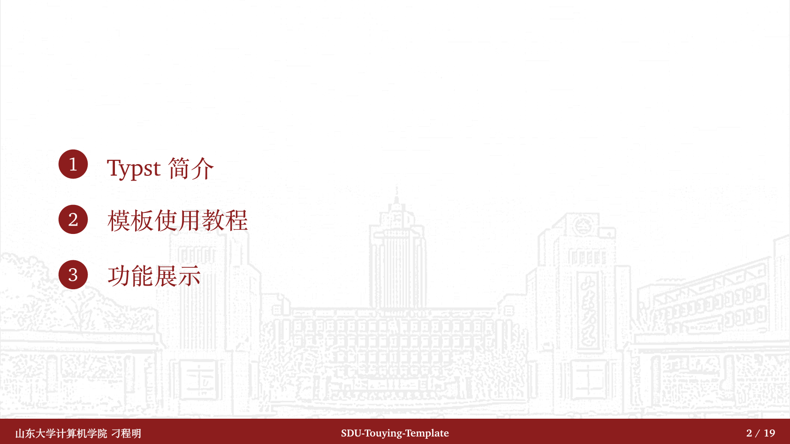
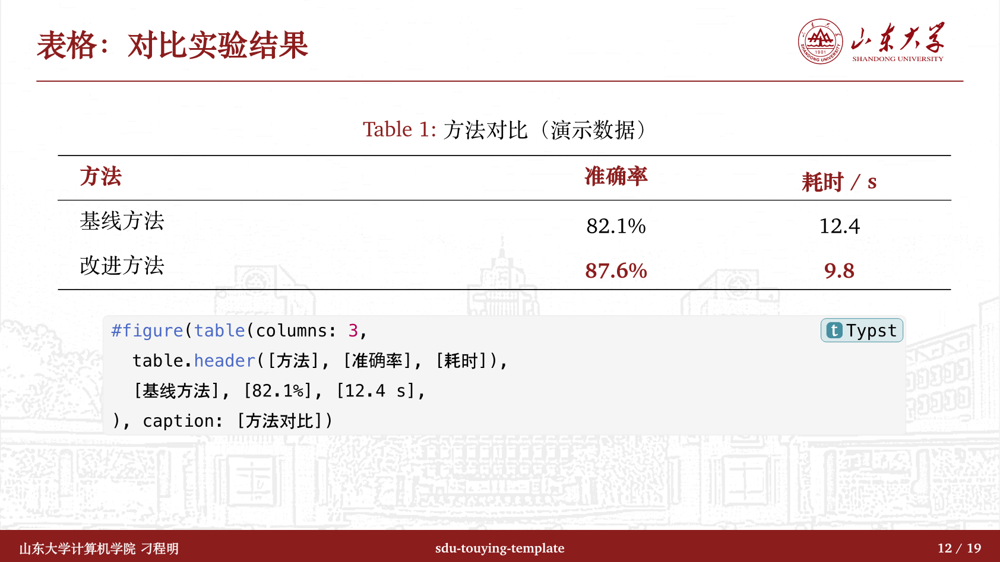
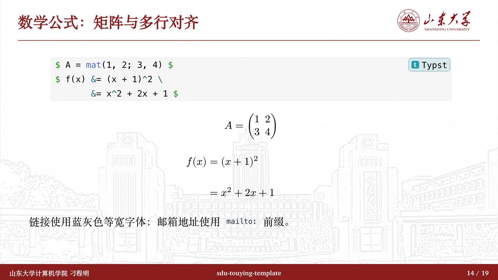
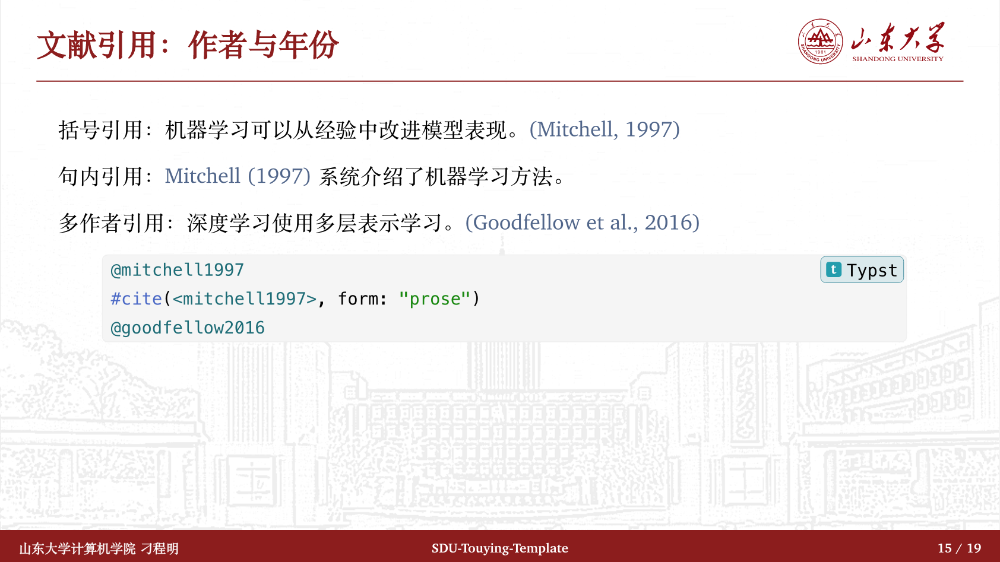

# sdu-smpl-slides

基于 Touying 的山东大学风格beamer，支持中文排版、目录、红色列表标记、三线表、数学公式、代码与作者—年份引用。

**sdu-smpl-slides 0.1.0** 已发布到 [Typst Universe](https://typst.app/universe/package/sdu-smpl-slides/)，包标识为 **`@preview/sdu-smpl-slides:0.1.0`**



## 快速开始

### 下载 Release ZIP 使用

你可从 [v0.1.0 Release](https://github.com/xmdjy/sdu-smpl-slides/releases/tag/v0.1.0) 下载 **`sdu-smpl-slides-v0.1.0.zip`** 源码包。安装 Typst **0.15.0 或更高版本**，解压后编译：

```sh
unzip sdu-smpl-slides-v0.1.0.zip
cd sdu-smpl-slides-v0.1.0
typst compile main.typ
```

打开生成的 `main.pdf` 预览，修改根目录的 `main.typ` 编写自己的报告，文献条目放在同目录的 `references.bib` 中。该附件已附带使用本地 `#import "lib.typ": *` 的入口，同时保留原始 `template/` 和主题源码；请保留 `lib.typ` 与 `image/` 的相对位置。首次编译仍需联网下载 Touying 等依赖，字体要求见下文。

### 通过 Typst Universe 使用

在 [Typst Universe 模板页面](https://typst.app/universe/package/sdu-smpl-slides/) 点击 **Create project in app**，即可在 Web 编辑器中创建项目；本地安装 Typst **0.15.0 或更高版本**后，也可运行：

```sh
typst init @preview/sdu-smpl-slides:0.1.0 slides
cd slides
typst compile main.typ
```

最小文稿：

```typst
#import "@preview/touying:0.8.0": *
#import "@preview/sdu-smpl-slides:0.1.0": *

#show: sdu-theme.with(config-info(
  title: [报告标题],
  author: [作者姓名],
  institution: [学院或单位],
  date: datetime.today(),
))
#title-slide()
#outline-slide()

= 第一章
== 第一张内容页
- 一个要点
- 行内公式：$x^2 + y^2$

== 致谢 <touying:unoutlined>
#end-slide()
```

一级标题生成章节页并进入目录，二级标题组织内容页。

## 功能预览

以下图片来自当前示例的同一次构建。

| 目录 | 三线表 |
| --- | --- |
|  |  |

| 数学公式 | 作者—年份引用 |
| --- | --- |
|  |  |

## 依赖版本与兼容性

最低编译器版本为 **Typst 0.15.0**。主题使用 Touying 0.8.0、Codly 2.0.0、codly-languages 0.1.10、gentle-clues 1.3.1 和 Lovelace 0.3.1；pinit 0.2.2、cuti 0.4.0 保持不变。

代码块已迁移到 Codly 2 的 `codly.new` 和组件配置规则；自定义代码样式时应使用新版接口，旧版 `codly-init` 和 `codly(...)` 配置方式不再适用。

## 自定义与字体

```typst
#show: sdu-theme.with(
  config-info(title: [报告标题], author: [作者姓名]),
  aspect-ratio: "16-9",
  primary: rgb("#8C1D1D"),
  font: ("Libertinus Serif", "Noto Serif CJK SC"),
  mono-font: "DejaVu Sans Mono",
)
```

`font` 设置正文候选字体，`mono-font` 设置代码和外部链接字体。默认候选包含 XCharter、Charter、Songti SC、FandolSong，以及 Maple Mono、Menlo、DejaVu Sans Mono。字体文件不随包分发；请安装所需字体或在 Web 编辑器上传字体，也可以指定本机已安装字体。缺失候选字体会产生警告并回退，跨平台输出可能略有不同。

文献使用 `@key` 或 `#cite(<key>, form: "prose")`，文稿中需放置 `#bibliography("references.bib", title: none)`。默认样式为 APA，引用保留衬线字体并显示为蓝灰色。


## 许可与素材来源

项目原创代码及示例采用 [MIT](LICENSE) 许可，通过包系统导入的 Touying、Codly 等依赖保留各自许可。素材图片符合[山东大学名誉管理办法](https://www.dbxb.sdu.edu.cn/info/1039/1984.htm)，所有素材来源均来自官方网站。

## 致谢

基于 [Touying](https://github.com/touying-typ/touying) 构建，参考 [touying-sjtu](https://github.com/sjtug/touying-sjtu) 的视觉与实现思路。问题和建议请提交到[项目 Issues](https://github.com/xmdjy/sdu-smpl-slides/issues)。
